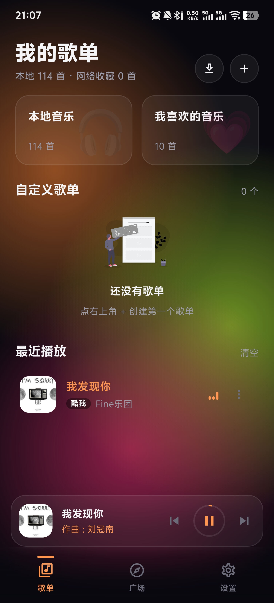
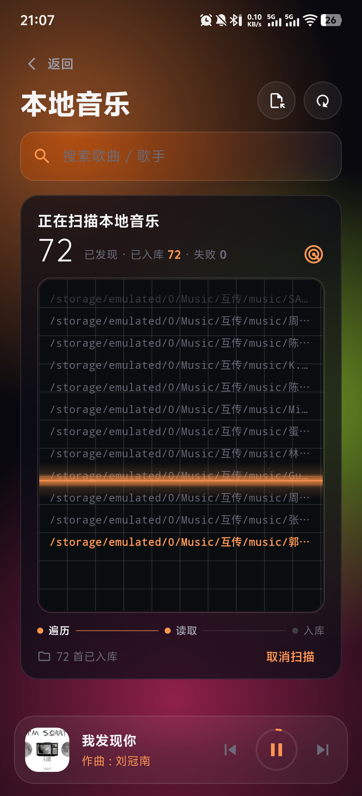
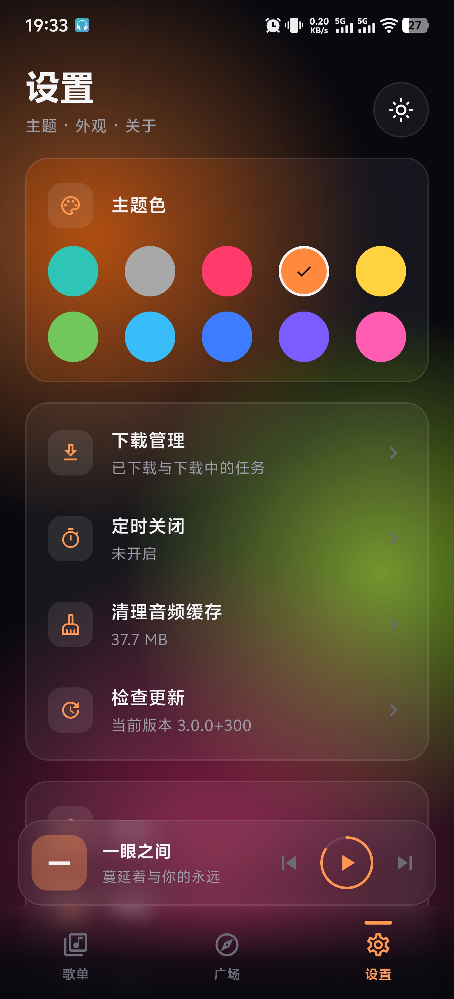
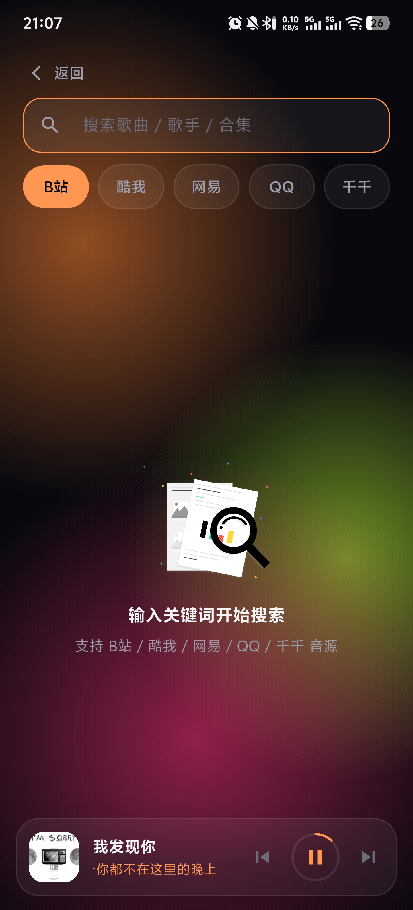
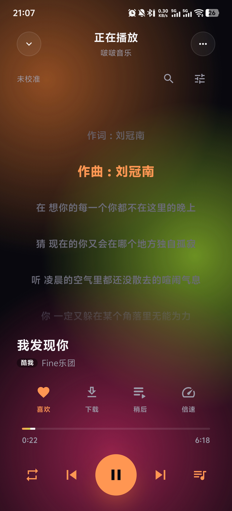

<div align="center">


# 啵啵音乐

**听歌自由 —— 无后端的跨平台本地音乐播放器**

<p>
  <a href="https://github.com/Redstone-1/bobomusic/releases"></a><a href="https://docs.flutter.dev/"></a><a href="#-平台支持"></a><a href="#"></a>
</p>

聚合五大主流公开音源与本地音乐，
歌单、歌词、下载、播放队列全部数据本地存储，无广告、无账号、无后端。

</div>

## 📸 应用预览

以下为 Android 界面截图；Windows 使用独立桌面布局。

<div align="center">

  <p align="center">
    
    
    
  </p>

  <p align="center">
    
    
    
  </p>

</div>


## ✨ 功能特色

**音源与播放**

- 🎧 多源聚合搜索：五大主流公开音源一站聚合，搜索页一键切换
- 📻 广场榜单：网易云热歌、飙升、原创、电音与千千新歌榜直接点播
- ▶️ 播放队列：待播放插队、合集批量加入、跨启动恢复
- ⏱️ 定时关闭：计时停止或播完当前再停
- 🕘 播放历史自动记录

**歌单与数据**

- 🎼 自由创建歌单、批量喜欢、本地音乐扫描导入；Windows 支持多目录扫描和同名文件保护
- ✏️ 自定义歌曲显示名称、歌手与封面，保留音源原始信息
- 💾 全部数据本地保存（SQLite + SharedPreferences），无账号体系
- 📥 下载离线听：复用播放缓存，支持暂停、继续、取消和校验续传

**歌词与体验**

- 📝 歌词多级智能检索：站内直连 → 开放歌词库 → 备选源，滚动、时间校准、搜索替换
- 🌌 沉浸式极光玻璃界面，深空黑等多主题换色
- 🔍 应用内检查更新

**系统集成**

- 🔔 Android 系统媒体卡与耳机控制；Windows 已接入系统媒体控制桥，运行验收见下方指南
- 🖥️ Windows 桌面布局、窗口恢复、常驻播放条、全高歌词、音量与快捷键

## 📥 下载

[GitHub Releases](https://github.com/Redstone-1/bobomusic/releases)（已发布版本）。Windows 可在 [构建 Windows 应用](https://github.com/Redstone-1/bobomusic/actions/workflows/release-windows.yaml) 手动选择分支运行，成功后从 Artifacts 下载安装包或便携包；手动运行不创建 Release。操作与验收见 [Windows 发布与验收](./windows/发布与验收.md)。

## 📱 平台支持

| 平台 | 状态 |
| --- | --- |
| Android | ✅ 正式发布 |
| Windows x64 | 🛠️ 桌面功能与打包流程已实现；本机已生成 Release 和安装包，完整运行验收中 |
| Linux | 🛠️ 开发联调；未启用 Windows 桌面壳 |
| iOS / macOS / Web | 🚧 未完成适配；macOS 仅同步桌面图标 |

## 🛠️ 从源码构建

```bash
git clone https://github.com/Redstone-1/bobomusic.git
cd bobomusic
flutter pub get
dart run build_runner build --delete-conflicting-outputs
flutter run          # 或 flutter build apk
```

工具链要求：Flutter 3.47.7 / Dart 3.13.5 / JDK 17（移动端构建）。
更多环境与签名细节见[安卓开发指南](./安卓开发指南.md)。Windows 还需 Visual Studio 的“使用 C++ 的桌面开发”工作负载及 Windows SDK；使用 `flutter run -d windows --debug`，或在 VS Code 选择“Windows 桌面（Debug）”后按 F5。安装包流程见 [Windows 发布与验收](./windows/发布与验收.md)。

## 🧱 技术栈

Flutter · Dart · Riverpod 3（codegen）· just_audio / media_kit · sqflite / sqflite_common_ffi · Kotlin / Swift / C++ 系统媒体桥

架构与协作约定见 [AGENTS.md](./AGENTS.md)。

## ⭐ Star 历史

<a href="https://www.star-history.com/#Redstone-1/bobomusic&Date">
 <picture>
   <source media="(prefers-color-scheme: dark)" srcset="https://api.star-history.com/svg?repos=Redstone-1/bobomusic&type=Date&theme=dark" />
   <source media="(prefers-color-scheme: light)" srcset="https://api.star-history.com/svg?repos=Redstone-1/bobomusic&type=Date" />
   
 </picture>
</a>

## 🤝 欢迎贡献

欢迎提交 [Issue](https://github.com/Redstone-1/bobomusic/issues) 与 [PR](https://github.com/Redstone-1/bobomusic/pulls)。

<a href="https://github.com/Redstone-1/bobomusic/graphs/contributors">
  
</a>

## 📄 声明

本项目为个人学习研究用途，不存储任何音频文件，全部音源来自各平台公开接口聚合。请支持正版，如有侵权请联系删除。
