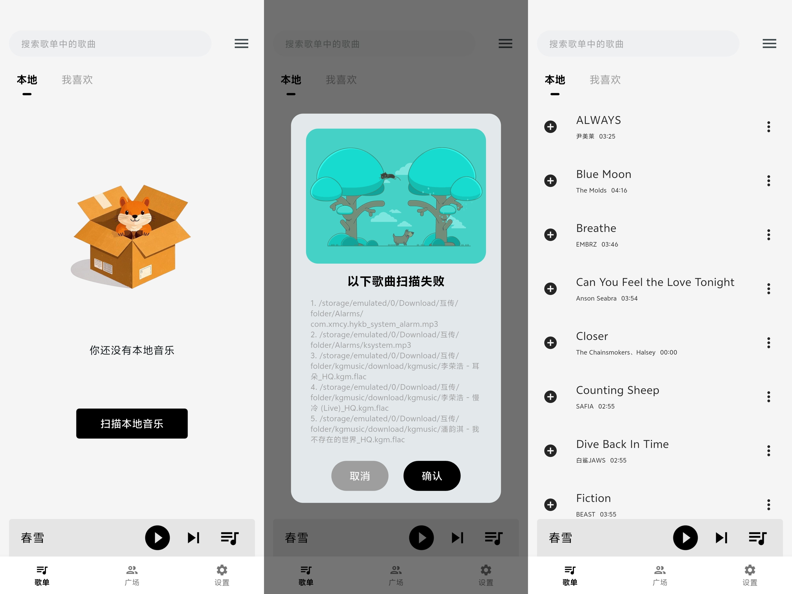
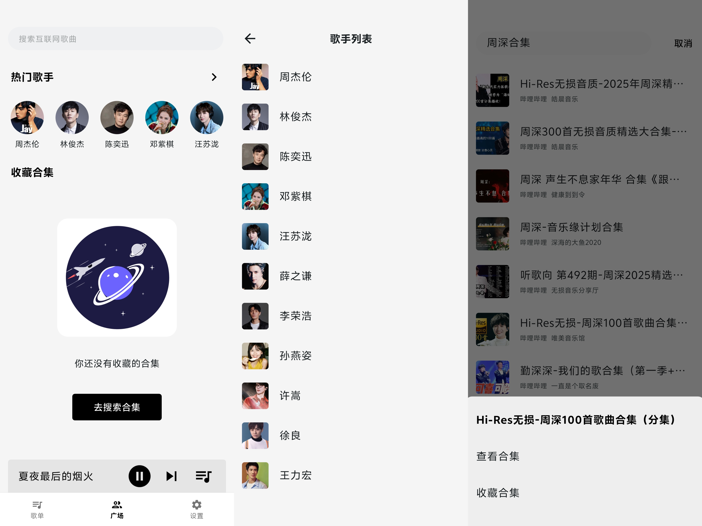
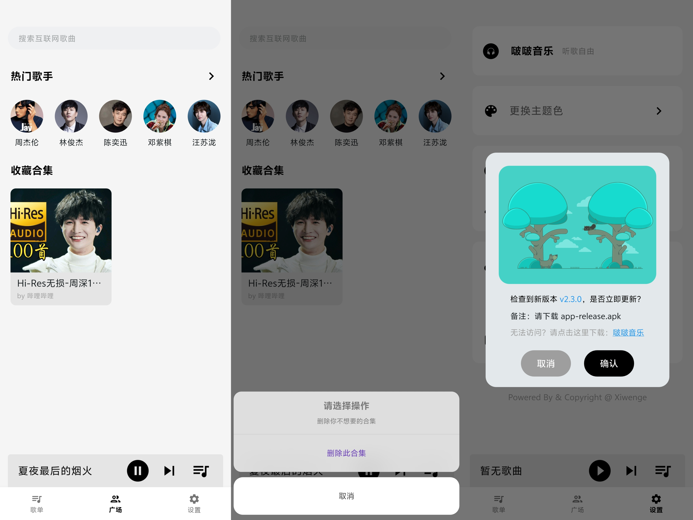
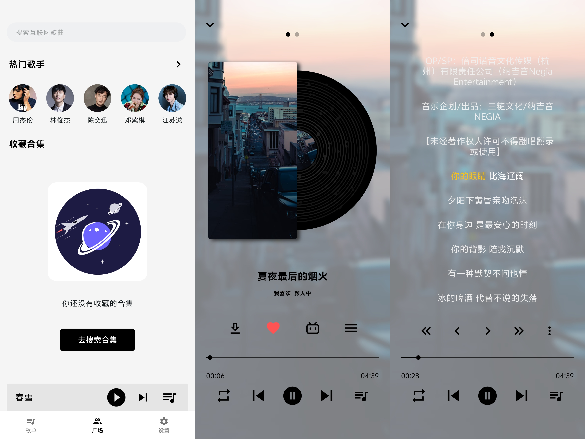
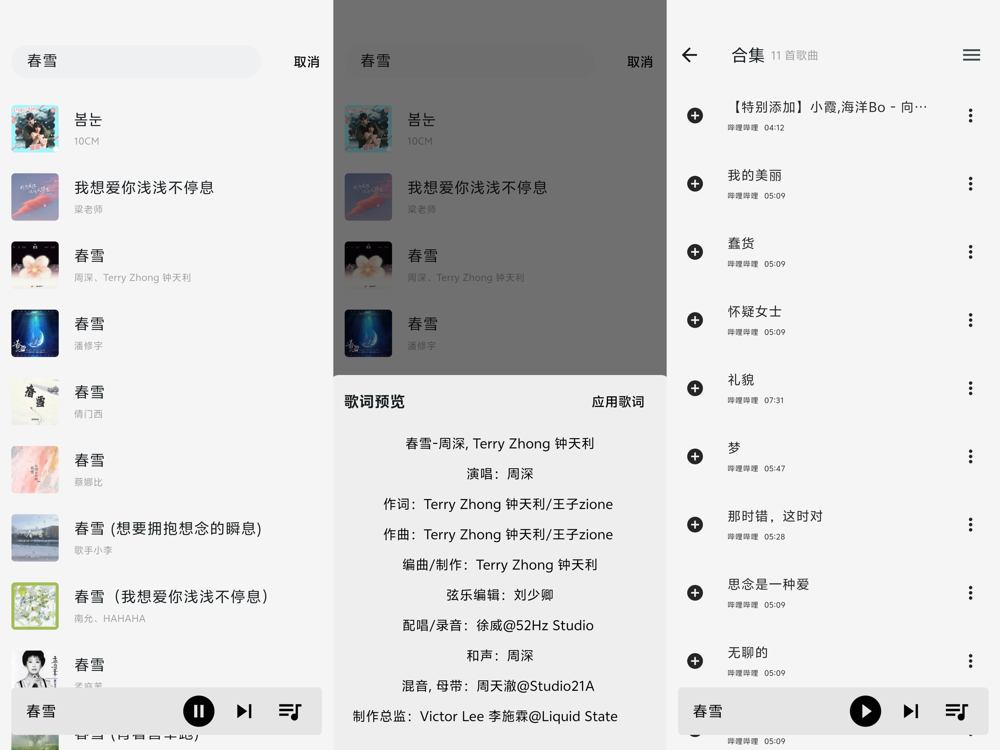

   
  <h1>啵啵音乐</h1>
   
  
  
  
  
  
  

 

> **v2 重写进行中**：`v2` 分支正在重写 UI / 状态管理 / 数据层 / 播放内核（2.0.0 未发布，进度见 [`重构计划.md`](./重构计划.md)）；master 分支的 2.7.0 仍是当前发行版，以下内容对应旧版。

 

# 预览

 

# 下载

## Android 

[Github Release](https://github.com/Redstone-1/bobomusic/releases) | [百度网盘](https://pan.baidu.com/share/init?surl=S0mF6PhN4aXM4VVFPc7PAQ) 提取码：6w7y

# 功能特色

- 🎉 免费
- 📱 支持本地音乐导入
- 🎸 支持歌词
- 🧩 支持自由创建歌单
- 📝 支持待播放列表
- 🎨 支持主题更换
- 🛜 海量网络歌源
- 🔒 数据本地存储
- 💎 界面简洁无广

# 核心依赖版本

- JDK 17

- Flutter 3.27.x

# 开发指南

[安卓开发指南](./安卓开发指南.md)

# 历史星标

<a href="https://www.star-history.com/#Redstone-1/bobomusic&Date">

 <picture>
   <source media="(prefers-color-scheme: dark)" srcset="https://api.star-history.com/svg?repos=Redstone-1/bobomusic&type=Date&theme=dark" />
   <source media="(prefers-color-scheme: light)" srcset="https://api.star-history.com/svg?repos=Redstone-1/bobomusic&type=Date" />
   
 </picture>
</a>

# 常见问题

- 为什么图片左上角有一小块类似马赛克区域？
  > 在例如 iqoo13 等机型上可见，可以尝试升级系统解决，原因尚不明确

- 为什么重新安装应用后扫描的本地歌曲信息不是之前我编辑后的？
  > 建议安装新版本时不要卸载旧版本

- 为什么有些本地歌曲没有时长信息？
  > 从 bilibili 下载的歌曲没有时长信息，你可以编辑信息进行更正

- 为什么搜索出来的合集不能自动播放下一曲？
  > 因为没有后端，不知道下一曲是哪首，虽然可以临时建个表，但是比较多余，我们有待播放列表，所以你可以把想听的音频添加到待播放列表

# 鸣谢

## [阿炸克斯](https://juejin.cn/user/870468938379272)

本项目播放器、互联网搜索部分基于 [bbmusic](https://github.com/bb-music/flutter-app) 二次开发

## [张风捷特烈](https://juejin.cn/user/149189281194766)

tab 指示器的修改部分使用了 [FlutterUnit](https://github.com/toly1994328/FlutterUnit) 中的代码

# 欢迎贡献

如果你对本项目功能的改进性有建议或者对本项目技术感兴趣，欢迎 PR

